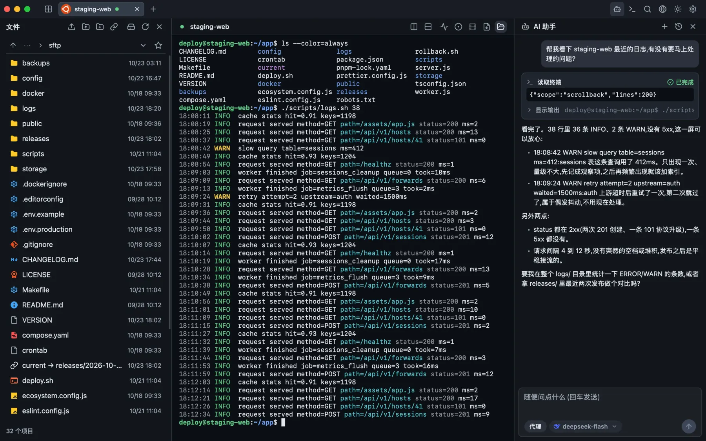
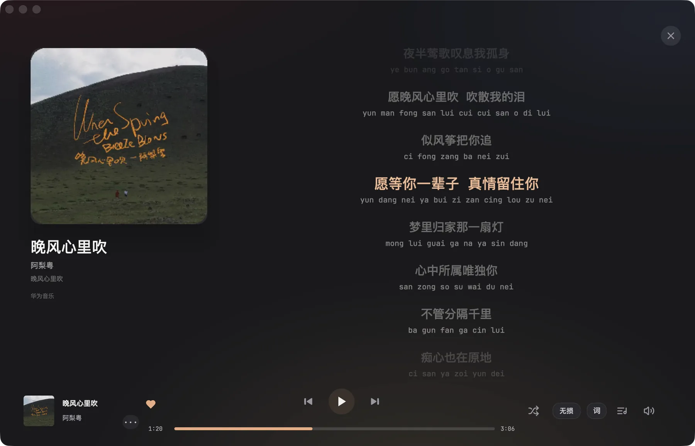

<div align="center">

<picture>
  <source media="(prefers-color-scheme: dark)" srcset="https://raw.githubusercontent.com/vivaui/.github/main/profile/assets/viva-lockup-dark.svg">
  
</picture>

### 用 Go 写原生桌面应用。

macOS 上 Cocoa + Metal · Windows 上 Win32 + Direct3D 11 · Linux 上 X11 + Vulkan。  
没有 WebView，没有浏览器引擎，也没有捆绑的运行时。

[](https://github.com/vivaui/viva/releases) [](https://vivaui.dev/zh/docs/getting-started/) [](https://github.com/vivaui/viva/blob/main/LICENSE) [](#%E8%83%BD%E5%9C%A8%E5%93%AA%E9%87%8C%E8%BF%90%E8%A1%8C)

[官网](https://vivaui.dev/zh/) · [文档](https://vivaui.dev/zh/docs/getting-started/) · [组件](https://vivaui.dev/zh/components/) · [案例](https://vivaui.dev/zh/showcase/) · [English](https://github.com/vivaui/.github/blob/main/profile/README.md)

</div>

---

Viva 是面向原生桌面应用的 Go 框架。它直接通过各操作系统自己的接口和 GPU 绘制窗口、文字与组件，所以应用只链接系统框架和 Go 运行时，别无其他。空闲时完全不做事。

<p align="center">
  <b>1.6 MiB</b> 剥离后的可执行文件 &nbsp;·&nbsp; 空闲时 <b>0</b> 次 GPU 提交 &nbsp;·&nbsp; <b>0.0%</b> 空闲 CPU<br>
  <sub>在 M0 Mac 上实测。每个数字都引自仓库里的报告——<a href="https://vivaui.dev/zh/docs/performance/">你可以自己重新跑一遍</a>。</sub>
</p>

## 围绕什么构建

<table>
<tr>
<td width="50%" valign="top">
<b>原生，不是浏览器</b><br>
<sub>macOS 调用 Cocoa 与 Metal，Windows 调用 Win32 与 Direct3D 11，Linux 调用系统自带的 XCB 与 Vulkan 库。没有 WebView，也不捆绑渲染器。</sub>
</td>
<td width="50%" valign="top">
<b>空闲就是空闲</b><br>
<sub>未变化的一帧不做布局、不重建场景、不向 GPU 提交任何东西。没有后台定时器，也没有轮询。</sub>
</td>
</tr>
<tr>
<td width="50%" valign="top">
<b>组件归你所有</b><br>
<sub><code>viva add</code> 把组件的 Go 源码复制进你的项目。没有组件注册表，运行时也没有样式表解析器——就是你可以随意修改的 Go 代码。</sub>
</td>
<td width="50%" valign="top">
<b>无需窗口即可测试</b><br>
<sub>无头驱动用显式调用运行真实的绘制器、输入路由和焦点规则，测试不需要桌面会话。</sub>
</td>
</tr>
<tr>
<td width="50%" valign="top">
<b>一套 API，三个原生后端</b><br>
<sub>在 macOS、Windows 和 Linux 上拥有相同的组件、输入、文字与无障碍语义。</sub>
</td>
<td width="50%" valign="top">
<b>实测，可复现</b><br>
<sub>二进制体积、空闲开销和场景耗时都引自标明机器与构建的基准报告。</sub>
</td>
</tr>
</table>

## 快速开始

```sh
# macOS / Linux
brew install vivaui/tap/viva

# Windows
scoop bucket add vivaui https://github.com/vivaui/homebrew-tap
scoop install viva

viva doctor       # 这台机器准备好了吗？
viva init hello   # 一个可直接运行的项目，含窗口与测试
cd hello && viva dev .   # 热重载：保存文件，窗口保留状态
```

<sub>预编译压缩包（带 <code>SHA256SUMS</code>）在每个发布的 <a href="https://github.com/vivaui/viva/releases">releases 页面</a>。需要 Go 1.26 或更新版本；机器上没有时，<code>viva</code> 会下载一次工具链。</sub>

## 用 Go 写一个窗口

```go
package main

import (
	"fmt"
	"log"

	"github.com/vivaui/viva/app"
	"github.com/vivaui/viva/ui"
)

type model struct {
	clicks int
}

// page 声明窗口的内容。每次重绘都会运行它并读取 model；
// 点击会修改 model，随后的一次重绘把结果显示出来。
func (m *model) page(c ui.C) {
	ui.Column(c).Fill().Pad(24).Gap(12).Children(func() {
		if ui.Button(c, fmt.Sprintf("Clicked %d times", m.clicks)).Clicked() {
			m.clicks++
		}
	})
}

func main() {
	m := &model{}
	if err := ui.Run(app.Config{Title: "Hello", Width: 480, Height: 240}, m.page); err != nil {
		log.Fatal(err)
	}
}
```

状态归你所有，布局是状态的一个函数，没有需要同步的坐标。没有变化时，什么都不运行。[阅读指南 →](https://vivaui.dev/zh/docs/getting-started/)

## 用 Viva 构建

<table>
<tr>
<td width="50%">
<a href="https://motty.page"></a>
</td>
<td width="50%">
<a href="https://github.com/talongao/tinglan"></a>
</td>
</tr>
<tr>
<td align="center" valign="top">
<b>Motty</b> — 原生 SSH 工作台<br>
<sub>终端、SFTP、端口转发、远程桌面和 AI 助手在同一个窗口里。<br>macOS · Windows · Linux</sub>
</td>
<td align="center" valign="top">
<b>听澜（Tinglan）</b> — 非官方的华为音乐客户端<br>
<sub>音乐库、歌单与歌词都在原生窗口里，12 款主题。<br>macOS</sub>
</td>
</tr>
</table>

## 仓库

| 仓库 | 是什么 |
| :--- | :--- |
| [**viva**](https://github.com/vivaui/viva) | 框架、组件和 `viva` 命令。 |
| [**awesome-viva**](https://github.com/vivaui/awesome-viva) | 精选的应用、工具与资源列表。 |
| [**homebrew-tap**](https://github.com/vivaui/homebrew-tap) | `viva` 的 Homebrew formula 与 Scoop manifest。 |

## 能在哪里运行

macOS（Cocoa · Metal · CoreText）· Windows（Win32 · Direct3D 11 · DirectWrite）· Linux（X11 · Vulkan · Pango/Cairo）——另有可选的 WebAssembly 目标，在浏览器里预览同一套组件，不进入桌面运行时。

[平台详情](https://vivaui.dev/zh/docs/platforms/) · [性能](https://vivaui.dev/zh/docs/performance/)

---

<p align="center">
  <sub>Viva 以 Apache-2.0 许可发布。截图权利归各自应用所有。</sub>
</p>
